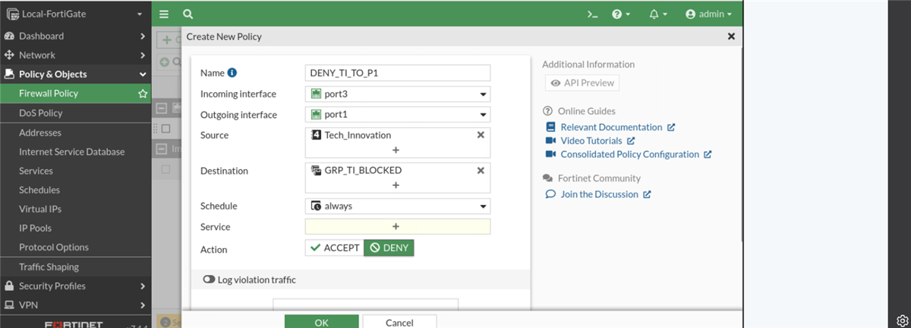

# Kaisa Incorporated — Local-FortiGate firewall policy implementation

An interactive engineering report for **Part B** of the Kaisa Incorporated security assessment.
The build configures department segmentation, time-based internet access, web filtering,
application control, source and destination NAT, and traffic shaping on a **FortiGate-VM64**
running **FortiOS 7.4.4** (hostname `Local-FortiGate`).

> **Live report:** [https://pcranay.github.io/kaisa-firewall-report/](https://pcranay.github.io/kaisa-firewall-report/)

[](index.html)
[](config/kaisa-fortigate-sanitised.conf)
[](config/firewall-policies.csv)
[](SECURITY.md)



## Why this repository exists

The written report explains the design; this repository makes it **explorable**. Instead of a
static PDF, the policy matrix is a working model: search the 18 rules, simulate a packet, inspect
the evaluation trace, compare every department pair, and check the implementation evidence.

It is also a deliberately honest artefact. Where the exported configuration differs from the
design intent, the difference is documented rather than hidden — see
[verification notes](docs/07-verification-notes.md).

## What is in scope

| Item | Detail |
| --- | --- |
| Device | `Local-FortiGate` · FortiGate-VM64 · FortiOS v7.4.4 build 2662 |
| Internal LAN | `port3` · 10.0.1.254/24 |
| Routed departments | `port1` · 10.200.1.1/24 |
| Internet path | `port2` · 10.200.2.1/24 → Linux router 10.200.2.254 |
| Out-of-band | `port8` · 172.16.100.3/24 (unchanged) |
| Policies | 18 deployed rules: 8 deny, 10 accept |
| NAT | SNAT pool 10.200.2.100–10.200.2.120 · VIP 10.200.2.1:8080 → 10.0.1.20:80 |
| Out of scope | ISFW, the 10.0.3.0/24 server interface, Remote-FortiGate (Part A) |

## Interactive features

- **Policy explorer** — full-text search, action and category filters, sortable by sequence ID,
  and a detail drawer with the equivalent FortiOS CLI for every rule.
- **Traffic simulator** — pick a source, destination and time window. The model applies policy
  order, group membership, schedules, ingress interfaces and the same-segment limitation, then
  shows a per-rule evaluation trace.
- **Interaction matrix** — all 64 source/destination pairs (including the web server and the
  internet) classified as allow, deny, implicit deny, L2-not-inspected or verify-interface.
- **Security profiles** — web filter, application control and traffic shaping, with the policy
  bindings and the break-time exception.
- **Verification checklist** — the 12 report tests with local-only progress tracking.
- **Evidence gallery** — cropped, sanitised screenshots from the GUI build, with captions.

## Repository map

```text
.
├─ index.html                     # interactive report (GitHub Pages entry point)
├─ assets/
│  ├─ site.css                    # dark/light design system, responsive layouts
│  ├─ data.js                     # single source of truth: objects, policies, tests
│  ├─ app.js                      # explorer, simulator, matrix, tabs, drawer, lightbox
│  ├─ logo.svg
│  └─ evidence/                   # cropped, sanitised screenshots
├─ config/
│  ├─ README.md                   # what was sanitised and why
│  ├─ kaisa-fortigate-sanitised.conf
│  ├─ firewall-policies.csv       # spreadsheet-friendly policy export
│  ├─ firewall-policies.json      # machine-readable policy export
│  ├─ interaction-matrix.csv
│  └─ design-intent-utm.md        # intended profile bindings (see verification notes)
├─ docs/
│  ├─ 01-report.md                # written report
│  ├─ 02-design-decisions.md
│  ├─ 03-policy-design.md
│  ├─ 04-security-profiles.md
│  ├─ 05-implementation.md
│  ├─ 06-testing.md
│  └─ 07-verification-notes.md
├─ SECURITY.md
└─ LICENSE
```

## Run locally

The site has no build step, no package manager and no external requests. Serve the repository
root over HTTP:

```bash
# Python 3
python -m http.server 8080
# then open http://localhost:8080/
```

```powershell
# PowerShell alternative
python -m http.server 8080
```

Opening `index.html` directly from disk also works, but a local server matches GitHub Pages more
closely.

## How the model works

`assets/data.js` is the single source of truth. Each policy carries its sequence ID, interface
pair, source and destination objects, schedule, NAT mode and profiles. The interface mirrors
the sanitised FortiOS export:

```js
{
  id: 16,
  name: 'ALLOW_INTERNET_WORKHOURS_AM',
  action: 'accept',
  src: ['TI', 'EX', 'PD', 'CS', 'ED', 'MS'],
  dst: ['NET'],
  srcintf: 'port3',
  dstintf: 'port2',
  schedule: 'WORK_HOUR_AM',
  nat: true,
  snat: 'IPPOOL_KAISA_SNAT',
  profiles: ['WF_KAISA_WorkHours', 'AC_KAISA', 'SHAPER_BUSINESS']
}
```

The simulator evaluates rules in sequence order and stops at the first match. It also models the
lab's physical limitation: three departments share 10.200.1.0/24, so traffic between them is
switched at layer 2 and never reaches the firewall.

## Policy summary

| Family | Count | Rules |
| --- | ---: | --- |
| Department isolation (deny) | 8 | `DENY_TI_TO_P1`, `DENY_BLOCKED_TO_TI`, `DENY_CS_TO_BLOCKED`, `DENY_BLOCKED_TO_CS`, `DENY_ED_TO_BLOCKED`, `DENY_BLOCKED_TO_ED`, `DENY_EX_TO_MS`, `DENY_MS_TO_EX` |
| Approved collaboration | 6 | `ALLOW_EX_TO_CS`, `ALLOW_CS_TO_EX`, `ALLOW_PD_TO_ED`, `ALLOW_ED_TO_PD`, `ALLOW_PD_TO_MS`, `ALLOW_MS_TO_PD` |
| Internet access | 3 | `ALLOW_INTERNET_WORKHOURS_AM`, `ALLOW_INTERNET_WORKHOURS_PM`, `ALLOW_INTERNET_BREAK` |
| Inbound publication | 1 | `ALLOW_INBOUND_WEBSERVER` |

The report's table groups the AM and PM internet policies into one line and therefore shows 17
requirements; the exported configuration contains **18** policy stanzas (sequence IDs 2–19).
This repository uses the deployed count everywhere.

## Sanitisation and privacy

Only firewall, address, NAT, schedule, shaper and policy objects are published. The following are
**excluded**: administrator accounts, password hashes, private keys, certificates, serial numbers,
logging configuration and all object UUIDs. Screenshots are cropped to remove the university lab
header and browser chrome.

See [config/README.md](config/README.md) and [SECURITY.md](SECURITY.md).

## Known limitations

- Three departments share one broadcast domain on `port1`; their mutual traffic is switched and
  cannot be filtered by the FortiGate. Production design: one VLAN per department.
- The internet policies accept ingress on `port3` only, so `port1` departments need a matching
  ingress policy or a routed/VLAN redesign.
- The exported PM internet policy and inbound VIP policy carry unexpected egress interfaces.
  These are flagged in the UI and documented in [verification notes](docs/07-verification-notes.md).

## Licence

Code and site implementation: MIT. Written report, diagrams and evidence: CC BY-NC 4.0.
See [LICENSE](LICENSE).

---

*Academic project. Not a production change record.*
